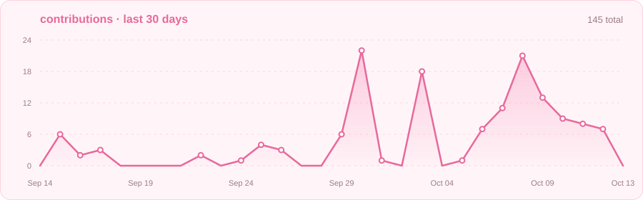
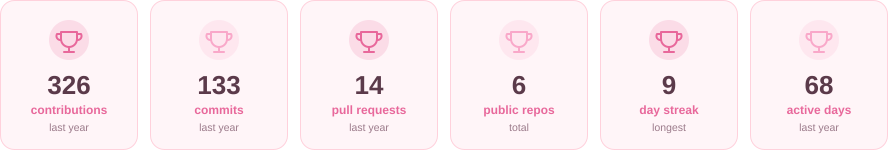

 

---

## ✿ about me

Hi, I'm **Ana Clara**. I'm a Computer Science senior at the **University of Central Florida** in Orlando, and I build full-stack web projects.

- 👩‍💻 Systems & Software Engineer Intern at Dual Drinks LLC
- 🎓 Teaching Assistant for **Computer Architecture** (250+ students) and **Senior Design II**
- 📝 Course Content Reviewer for UCF's **AI for Software Engineering** curriculum (COP 4932)
- 🔍 Growing interest in **AI tooling** and **fraud detection systems**

---

## ✿ tech stack

 

---

## ✿ projects

<table>
  <tr>
    <td width="50%" valign="top">
      <h3>🏠 <a href="https://github.com/anaaclra04/idx-property-search">IDX Property Search</a></h3>
      
A Zillow/Redfin-style property search experience backed by real MLS data. Browse, filter and explore listings with full detail pages, interactive maps and open house schedules.

      
      
      
      
      
      
      
      
    </td>
    <td width="50%" valign="top">
      <h3>💸 <a href="https://github.com/nicog3314/montra">Montra</a></h3>
      
<em>Track Smarter. Spend Safer.</em> · group project 
      Full-stack personal finance app with AI/ML-based fraud detection, risk scoring on transactions and a debt-minimization algorithm improved from O(N²) to O(N), validated with Pytest.

      
      
      
      
      
    </td>
  </tr>
  <tr>
    <td width="50%" valign="top">
      <h3>🧳 <a href="https://github.com/brocw/mern-travel-agent">TripTastic</a></h3>
      
<em>Formerly TripTally</em> · group project 
      MERN travel app with Google Maps API integration, SendGrid for email, and JWT/bcrypt authentication.

      
      
      
      
    </td>
    <td width="50%" valign="top">
      <h3>🤿 DiverDex</h3>
      
Cross-platform Flutter app backed by a normalized MySQL schema and parameterized SQL queries.

      
      
    </td>
  </tr>
</table>

---

## ✿ github stats

 

---

## ✿ activity

---

## ✿ trophies

---

## ✿ contributions

---

## ✿ let's connect

  

